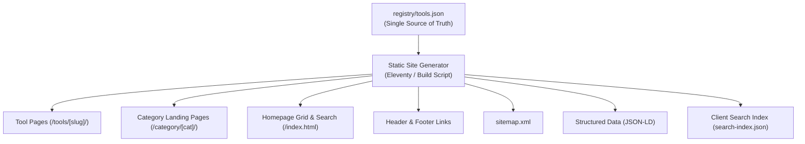

# ToolsBuilt Target Architecture Plan

**Document Version:** 1.0.0  
**Date:** October 2026  
**Author:** Senior Staff Engineer  
**Target Platform:** GitHub Pages (Static Hosting, Custom Domain `toolsbuilt.com`)  
**Target Branch:** `chore/audit-and-architecture`

---

## 1. Architectural Vision & Core Principles

ToolsBuilt's mission is to become one of the premier free online calculators and web tools websites globally. To achieve this, the technical architecture must be engineered around five foundational tenets:

1. **Static-First & Zero Server Dependency:** All pages must compile to pure, static HTML, CSS, and client-side JavaScript deployable directly to GitHub Pages (or any CDN such as Cloudflare Pages / AWS S3 + CloudFront). No backend servers, serverless cold starts, or database queries.
2. **100% Client-Side Privacy:** All computation, conversion, parsing, hashing, and generation occurs exclusively in the user's browser using modern Web APIs (`crypto.getRandomValues`, `SubtleCrypto`, HTML5 Canvas, File API, Web Workers). Zero user inputs, text, or files are uploaded to any server.
3. **Single Source of Truth (SSOT) via Tool Registry:** A unified, typed data registry defines every tool's metadata, category, schema, routing, and relations. Site navigation, category pages, search indexes, sitemaps, and cross-links are auto-generated from this registry.
4. **Sub-1.5s Mobile Performance & Zero Bloat:** No heavy client-side UI frameworks (no React, Vue, or Angular runtime). The client-side footprint must remain under 15 KB JS and 25 KB CSS per tool page.
5. **Rock-Solid E-E-A-T & SEO:** Automated JSON-LD structured data generation, static HTML linking (for search crawler equity), canonical management, automated XML sitemaps, and author/reviewer attribution.

---

## 2. The Unified Tool Registry (`registry/tools.json`)

To eliminate manual duplication across pages, navigation menus, footers, search, and sitemaps, every tool in ToolsBuilt will be registered in a centralized, data-driven registry.

### 2.1 Registry Schema Specification

```typescript
export interface ToolAuthor {
  name: string;
  role: string;
  credentials?: string;
  url?: string;
}

export interface ToolFAQ {
  question: string;
  answer: string;
}

export interface ToolHowToStep {
  name: string;
  text: string;
}

export interface ToolDefinition {
  // Identification & Routing
  id: string;                      // Unique slug (e.g., "age-calculator")
  slug: string;                    // URL path (e.g., "/tools/age-calculator/")
  name: string;                    // Display title (e.g., "Age Calculator")
  h1: string;                      // On-page H1 heading
  
  // Categorization & Taxonomy
  category: string;                // Category display name (e.g., "Date & Time")
  categoryId: string;              // Category slug (e.g., "date-time")
  tags: string[];                  // Filter keywords (e.g., ["birthday", "countdown", "years"])
  icon: string;                    // SVG icon identifier from icon registry
  
  // Search Engine & Metadata
  metaTitle: string;               // 50-60 char title tag
  metaDescription: string;         // 140-160 char meta description
  canonical: string;               // Full canonical URL
  ogImage: string;                 // Path to 1200x630 social card
  twitterCard: "summary" | "summary_large_image";
  
  // Editorial & E-E-A-T
  status: "published" | "draft" | "planned";
  priority: 1 | 2 | 3;             // 1 = High, 2 = Medium, 3 = Low
  popular: boolean;                // Featured on homepage & footer
  datePublished: string;           // ISO 8601 (e.g., "2026-10-11")
  dateModified: string;            // ISO 8601 (e.g., "2026-10-15")
  author: ToolAuthor;
  reviewedBy?: ToolAuthor;
  standardsCited?: string[];       // Standards (e.g., ["ISO 8601", "NIST SP 800-63B"])
  
  // Relationships & Graph
  relatedToolIds: string[];        // Array of related tool IDs for cross-linking
  
  // Structured Data Content
  applicationCategory: string;     // Schema.org category (e.g., "UtilitiesApplication")
  howToSteps: ToolHowToStep[];     // Schema.org HowTo steps
  faqs: ToolFAQ[];                 // Schema.org FAQPage questions and answers
}
```

### 2.2 What the Registry Powers Automatically



1. **Tool Pages:** Generates HTML title, meta tags, Open Graph, breadcrumbs, H1, FAQs, and statically pre-rendered Related Tool cards.
2. **Category Hub Pages:** Generates `/category/[category-id]/index.html` with curated lists and optimized category meta descriptions.
3. **Homepage:** Populates category grids, popular tool lists, and hero search data.
4. **Navigation & Footer:** Auto-generates popular tool links and category dropdowns without manual HTML edits.
5. **SEO & Structured Data:** Automatically creates valid `WebApplication`, `BreadcrumbList`, `HowTo`, and `FAQPage` JSON-LD schemas.
6. **Sitemap:** Automatically compiles `sitemap.xml` with verified `<loc>` and `<lastmod>` timestamps.
7. **Client Search Index:** Builds a lightweight (~10 KB) JSON search index loaded on demand when the user focuses the hero search box.

---

## 3. Layout Partials & Component Architecture

To eliminate the 17-file duplication documented in `AUDIT.md`, all common markup is extracted into modular layout templates.

### 3.1 Template Hierarchy

```
src/_includes/
├── layouts/
│   ├── base.njk               # Root HTML5 shell (head, theme script, header, footer)
│   ├── tool.njk               # Tool shell (breadcrumbs, header, tool container, article, FAQs, related)
│   ├── category.njk           # Category hub layout (hero, tool card grid, category guide)
│   └── page.njk               # Content page layout (about, contact, legal)
└── partials/
    ├── meta-head.njk          # Title, canonical, OG/Twitter, favicon, DNS-prefetch
    ├── theme-init.njk         # Blocking 1-line script preventing dark-mode FOUC
    ├── header.njk             # Logo, navigation bar, dark theme toggle, mobile drawer
    ├── footer.njk             # Brand info, popular tools, legal links, copyright
    ├── tool-card.njk          # Reusable card component for grids and related tools
    ├── faq-accordion.njk      # Accessible WAI-ARIA accordion component
    ├── related-tools.njk      # Statically compiled related tools grid
    └── schema-jsonld.njk      # Dynamic Schema.org JSON-LD generator
```

### 3.2 Key Layout Specifications

#### Base Shell (`base.njk`)
* Injects `<meta-head>` with dynamic title, canonical, Open Graph PNG, and Twitter cards.
* Injects `<theme-init>` immediately at the top of `<head>` to prevent the dark-mode FOUC identified in `AUDIT.md`:
  ```html
  <script>(function(){const t=localStorage.getItem('theme');if(t)document.documentElement.setAttribute('data-theme',t);})();</script>
  ```
* Wraps content in `<a href="#main-content" class="skip-link">Skip to main content</a>` for WCAG 2.1 AA accessibility.
* Renders global `<header>` and `<footer>` components.
* Conditionally includes Google Analytics only in production builds.

#### Tool Page Template (`tool.njk`)
* **Breadcrumbs:** Structured breadcrumb navigation (`Home > Category > Tool Name`).
* **Tool Workspace:** Clean, card-styled container containing the tool's form inputs and results box with `aria-live="polite"`.
* **Editorial & Standards Section:** Author byline, last reviewed date, calculation methodology, and cited standards (ISO, NIST, etc.).
* **FAQ Accordion:** Rendered from registry FAQs using accessible WAI-ARIA accordion buttons.
* **Statically Compiled Related Tools:** 3 curated related tool cards compiled into static HTML so search crawlers pass link equity without needing client JavaScript.

---

## 4. Build System Evaluation & Recommendation

We evaluated three potential build strategies against the project's strict criteria: zero-server GitHub Pages hosting, minimal friction, maximum performance, and maintenance simplicity.

### 4.1 Comparison Matrix

| Evaluation Criteria | Option A: Minimal Node.js Build Script | Option B: Eleventy (11ty) v3.x | Option C: Astro |
| :--- | :--- | :--- | :--- |
| **External Dependencies** | Zero or 1 (e.g. `ejs`/`mustache`) | Minimal (`@11ty/eleventy`) | Moderate (`astro`, Vite, plugins) |
| **Build Speed (100 tools)** | < 100ms | < 350ms | 1.5s – 3.0s |
| **Output Format** | Pure static HTML/CSS/JS | Pure static HTML/CSS/JS | Pure static HTML/CSS/JS |
| **Client JS Runtime** | **0 KB** (None) | **0 KB** (None) | **0 KB** (By default) |
| **Template Flexibility** | Manual string templates | Nunjucks, Liquid, Markdown | Astro `.astro` components |
| **Category Pagination** | Manual script logic required | Built-in data pagination | Built-in `getStaticPaths()` |
| **Migration Friction** | Low, but high ongoing custom code | **Extremely Low** (drop-in HTML) | Medium (convert to JSX-like syntax) |
| **Developer Ergonomics** | Low (reinventing template engine) | **High** (watch mode, live reload) | High (Vite HMR) |
| **Maintenance Burden** | High (custom build code to maintain)| **Very Low** (standard OSS engine) | Low |

### 4.2 Recommended Choice: Option B — Eleventy (11ty) v3.x

**Strategic Justification:**
1. **Zero Client Runtime Overhead:** Eleventy generates 100% pure static HTML. It introduces zero client-side JavaScript libraries, runtimes, or hydration scripts, perfectly matching our goal of maximum speed.
2. **Lowest Migration Friction:** Existing HTML files can be migrated directly into Nunjucks (`.njk`) templates with zero changes to existing CSS or tool-specific JavaScript files.
3. **Native Data-Driven Capabilities:** Eleventy natively consumes `registry/tools.json` through its global data cascade (`_data/tools.json`). Generating 80+ tool pages, 11 category landing pages, and `sitemap.xml` requires under 50 lines of configuration.
4. **Built-in Development Server:** Provides local hot-reloading (`npx @11ty/eleventy --serve`) without external bundlers.
5. **Long-Term Stability:** 11ty has zero lock-in and a proven track record of maintaining backwards compatibility without churn.

*(Note: If the project strictly mandates zero npm dependencies during the initial transition, Option A—a custom 150-line Node.js build script utilizing Node's native `fs` and string template literals—can be implemented first and swapped to Eleventy later without altering the registry or folder structure).*

---

## 5. Target Folder Structure & Naming Conventions

### 5.1 Proposed Directory Layout

```
toolsbuilt/
├── .github/
│   └── workflows/
│       └── deploy.yml              # GitHub Actions CI/CD for build & Pages deploy
├── .nojekyll                       # GitHub Pages Jekyll bypass
├── CNAME                           # toolsbuilt.com
├── package.json                    # Minimal build scripts & dev dependencies
├── eleventy.config.js              # 11ty configuration
├── src/
│   ├── _data/
│   │   ├── categories.json         # Category definitions & metadata
│   │   ├── site.json               # Site-wide settings (URL, name, GA ID)
│   │   └── tools.json              # Master Tool Registry
│   ├── _includes/
│   │   ├── layouts/                # Base, Tool, Category, Content layouts
│   │   └── partials/               # Header, Footer, Meta, Accordion, Cards
│   ├── assets/
│   │   ├── css/
│   │   │   ├── base.css            # Reset, tokens, typography, dark mode
│   │   │   ├── components.css      # Header, footer, cards, buttons, forms
│   │   │   └── tools/              # Tool-specific scoped CSS modules
│   │   ├── img/
│   │   │   ├── apple-touch-icon.png# Valid 180x180 PNG
│   │   │   ├── favicon.svg         # SVG favicon
│   │   │   └── og-image.png        # Valid 1200x630 PNG social preview
│   │   └── js/
│   │       ├── core/               # Shared client-side tool utilities module
│   │       │   ├── math-utils.js
│   │       │   ├── date-utils.js
│   │       │   ├── crypto-utils.js
│   │       │   ├── text-utils.js
│   │       │   ├── clipboard.js
│   │       │   └── a11y.js
│   │       └── common.js           # Theme toggle, search, mobile drawer
│   ├── categories/
│   │   └── category.njk            # Template generating /category/[id]/index.html
│   ├── pages/
│   │   ├── index.njk               # Homepage
│   │   ├── about.njk               # /about/
│   │   ├── contact.njk             # /contact/
│   │   ├── privacy-policy.njk      # /privacy-policy/
│   │   ├── terms.njk               # /terms/
│   │   └── 404.njk                 # /404.html
│   ├── sitemap.xml.njk             # Dynamically compiled sitemap
│   ├── robots.txt                  # Static crawler instructions
│   └── tools/                      # Tool templates & logic
│       ├── age-calculator/
│       │   ├── index.njk           # Markup & content (inherits tool.njk)
│       │   └── script.js           # Pure client-side logic
│       └── [other-tools]/
├── scripts/
│   ├── check-links.js              # Automated internal link & JSON-LD checker
│   └── test-all.js                 # Algorithmic & mathematical regression suite
└── _site/                          # Compiled static output deployed to GitHub Pages
```

### 5.2 Naming Conventions
* **URLs & Slugs:** Lowercase, hyphen-delimited, trailing slash: `/tools/[category]-[action]/` or `/tools/[action]-[object]/` (e.g., `/tools/discount-calculator/`, `/tools/json-formatter/`).
* **Tool IDs:** Exact match to slug: `discount-calculator`.
* **CSS Classes:** BEM-inspired lowercase with hyphens: `.tool-card`, `.tool-card__header`, `.tool-card--featured`.
* **JavaScript Files:** Lowercase hyphen-separated (`math-utils.js`, `date-utils.js`).
* **HTML Element IDs:** Lowercase hyphen-separated: `#start-date`, `#result-box`, `#copy-btn`.

---

## 6. Shared Client-Side "Tool Utilities" Module

Currently, every tool reinvents input parsing, clipboard copying, date formatting, and DOM updates. A shared, tree-shakeable utility library (`/assets/js/core/`) will be introduced to standardize algorithmic precision, error handling, and accessibility.

### 6.1 Module Structure

```
assets/js/core/
├── a11y.js          # Live region announcer, focus management
├── clipboard.js     # Clipboard API with fallback and visual toast
├── crypto-utils.js  # Unbiased CSPRNG, entropy calculation, hashing
├── date-utils.js    # Clamped month arithmetic, leap year, business days
├── math-utils.js    # Safe float arithmetic, percentage rounding, formatting
└── text-utils.js    # Tokenizer, case transformations, slugifier
```

### 6.2 Key Utility Signatures

```javascript
// a11y.js: Accessible screen reader announcements
export function announce(message, priority = 'polite') {
  let liveRegion = document.getElementById('a11y-live-region');
  if (!liveRegion) {
    liveRegion = document.createElement('div');
    liveRegion.id = 'a11y-live-region';
    liveRegion.className = 'sr-only';
    liveRegion.setAttribute('aria-live', priority);
    liveRegion.setAttribute('role', 'status');
    document.body.appendChild(liveRegion);
  }
  liveRegion.textContent = '';
  setTimeout(() => { liveRegion.textContent = message; }, 50);
}

// clipboard.js: Copy with visual feedback
export async function copyToClipboard(text, buttonElement, successMsg = 'Copied!') {
  try {
    await navigator.clipboard.writeText(text);
    const originalText = buttonElement.innerHTML;
    buttonElement.classList.add('btn--copied');
    buttonElement.textContent = successMsg;
    announce(successMsg);
    setTimeout(() => {
      buttonElement.innerHTML = originalText;
      buttonElement.classList.remove('btn--copied');
    }, 2000);
    return true;
  } catch (err) {
    console.error('Failed to copy: ', err);
    return false;
  }
}

// math-utils.js: Avoid float precision errors (0.1 + 0.2 = 0.30000000000000004)
export function roundTo(number, decimals = 2) {
  const factor = Math.pow(10, decimals);
  return Math.round((number + Number.EPSILON) * factor) / factor;
}

export function formatCurrency(amount, currency = 'USD') {
  return new Intl.NumberFormat('en-US', { style: 'currency', currency }).format(amount);
}

// crypto-utils.js: Cryptographically secure unbiased random selection
export function getRandomInt(min, max) {
  const range = max - min + 1;
  const maxValid = Math.floor(0x100000000 / range) * range;
  const buffer = new Uint32Array(1);
  while (true) {
    window.crypto.getRandomValues(buffer);
    if (buffer[0] < maxValid) {
      return min + (buffer[0] % range);
    }
  }
}
```

---

## 7. Performance Budgets & Lighthouse Targets

To maintain best-in-class user experience and gain search ranking advantages, all pages built under the new architecture must adhere to strict performance budgets:

### 7.1 Target Lighthouse 10.0 Scores
* **Performance:** **98 – 100**
* **Accessibility (WCAG 2.1 AA):** **100**
* **Best Practices:** **100**
* **SEO:** **100**

### 7.2 Core Web Vitals Budgets (Mobile 4G Emulation)
* **Largest Contentful Paint (LCP):** **< 1.2s** (Well under Google's 2.5s "Good" threshold).
* **First Input Delay / Interaction to Next Paint (INP):** **< 50ms** (Instant calculation feedback).
* **Cumulative Layout Shift (CLS):** **< 0.01** (Zero layout jumps; fixed dimensions for UI elements and ad placeholders).
* **Total Blocking Time (TBT):** **< 50ms**.

### 7.3 Page Weight Budgets
* **HTML Payload:** < 15 KB (Gzipped).
* **Global CSS:** < 20 KB (Minified/Gzipped).
* **Tool-Specific CSS:** < 3 KB.
* **Global JavaScript:** < 8 KB.
* **Tool-Specific JavaScript:** < 10 KB.
* **External Third-Party Requests:** 1 (Google Analytics, loaded with `async` deferred attribute; zero blocking).

---

## 8. CI/CD Deployment Pipeline (GitHub Actions)

A GitHub Actions workflow will automate code quality, regression testing, static generation, and deployment to GitHub Pages.

```yaml
name: Build and Deploy to GitHub Pages

on:
  push:
    branches:
      - main
  pull_request:
    branches:
      - main

permissions:
  contents: read
  pages: write
  id-token: write

concurrency:
  group: "pages"
  cancel-in-progress: true

jobs:
  test:
    runs-on: ubuntu-latest
    steps:
      - name: Checkout Repository
        uses: actions/checkout@v4

      - name: Setup Node.js
        uses: actions/setup-node@v4
        with:
          node-version: 20

      - name: Install Dependencies
        run: npm ci

      - name: Run Mathematical & Algorithmic Regression Suite
        run: node scripts/test-all.js

      - name: Verify Links, Canonical URLs & Structured Data
        run: node scripts/check-links.js

  build-and-deploy:
    needs: test
    if: github.ref == 'refs/heads/main'
    runs-on: ubuntu-latest
    steps:
      - name: Checkout Repository
        uses: actions/checkout@v4

      - name: Setup Node.js
        uses: actions/setup-node@v4
        with:
          node-version: 20

      - name: Install Dependencies
        run: npm ci

      - name: Build Static Site
        run: npm run build

      - name: Setup GitHub Pages
        uses: actions/configure-pages@v4

      - name: Upload Artifact
        uses: actions/upload-pages-artifact@v3
        with:
          path: '_site'

      - name: Deploy to GitHub Pages
        id: deployment
        uses: actions/deploy-pages@v4
```

---

## 9. Migration Roadmap & Zero-Downtime Guarantee

1. **Step 1 (Audit & Architecture - Completed):** Establish baseline, verify known defects, write `/docs/AUDIT.md`, `/docs/ARCHITECTURE_PLAN.md`, and `/docs/TOOLS_BACKLOG.md`.
2. **Step 2 (Build Engine Setup):** Initialize `package.json`, install Eleventy v3, configure `eleventy.config.js`, and setup the GitHub Actions workflow.
3. **Step 3 (Registry & Layout Extraction):** Populate `src/_data/tools.json` with the 10 existing tools. Build `base.njk`, `tool.njk`, `header.njk`, and `footer.njk`.
4. **Step 4 (Image Asset Remediation):** Replace vector `apple-touch-icon.png` with a 180x180 PNG raster. Generate `assets/img/og-image.png` (1200x630 PNG).
5. **Step 5 (Tool Migration & Content Fixes):** Migrate the 10 existing tools into the template engine. Correct the Age Calculator legal/biological text. Add `aria-live` to dynamic tool outputs.
6. **Step 6 (Category Pages & Verification):** Generate static category pages (`/category/date-time/`, etc.). Run `test-all.js` and `check-links.js` with 100% pass rate.
7. **Step 7 (Catalog Expansion):** Begin rolling out the 80+ tools cataloged in `/docs/TOOLS_BACKLOG.md` in prioritized phases.
